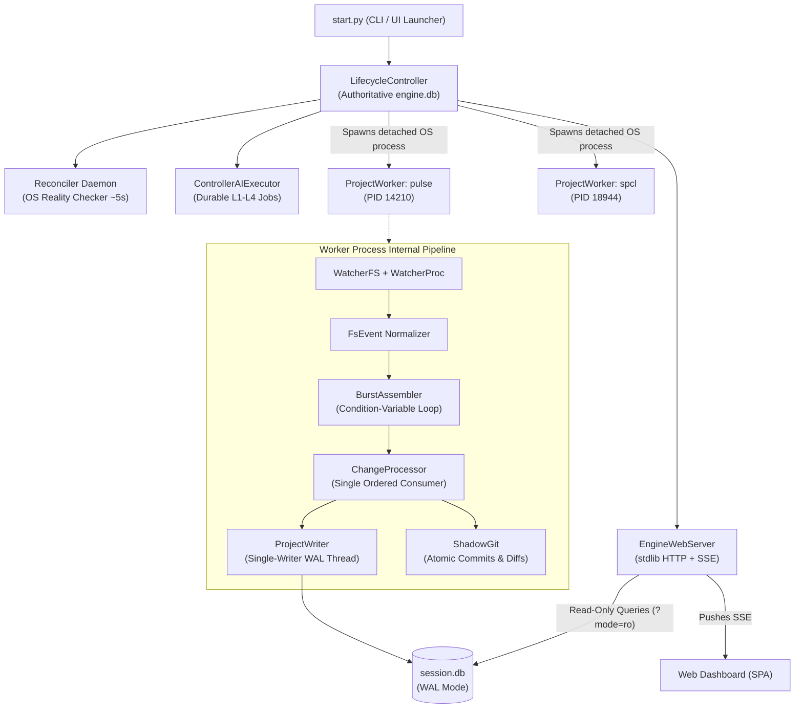
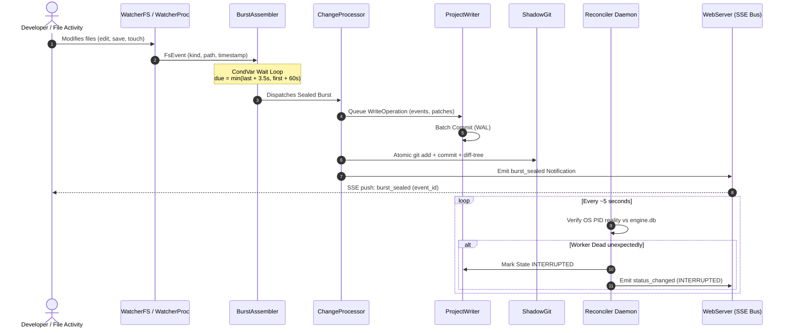

# SPD Analysis Engine: Current Production Architecture

> **Document Type:** Production Architecture Reference & System Specification  
> **Target Codebase:** `spd_analysis_engine/`  
> **Status:** Current & Verified against Live Python Implementation  
> **Date:** October 2026  

---

## 1. Architectural Overview & Core Invariants

The **SPD Analysis Engine** is a high-reliability, local-first filesystem monitoring, telemetry collection, and micro-versioning system. It is designed to observe developer workspaces, capture discrete editing bursts, persist atomic unified diffs into a shadow Git repository, log file operations in SQLite, and dispatch asynchronous AI analysis jobs without degrading editor performance.



### Core Invariants Enforced in Code:
1. **Single Lifecycle Authority:** Only one authoritative `LifecycleController` operates per engine instance. Web servers receive the controller via dependency injection and never instantiate their own supervisors.
2. **Process Crash Isolation:** Every monitored project runs in a detached OS process. Worker crashes do not compromise the web server, the controller, or other running workers.
3. **Strict Read-Only Reads:** HTTP GET endpoints perform zero database writes, zero DDL, zero WAL checkpoints, zero directory synthesis, and zero auto-archiving.
4. **Single-Writer Database Architecture:** Each project’s `session.db` is written exclusively by a dedicated `ProjectWriter` thread. Readers use independent connections opened in URI read-only mode (`?mode=ro`).
5. **Timerless Debounce Pipeline:** Burst assembly utilizes condition-variable wait loops (`due = min(last + quiet, first + max)`) rather than volatile `threading.Timer` instances.
6. **Git Attribution Durability:** Git micro-commits never execute `--allow-empty`. Commits scale to 2,000+ files via pathspec files. Git failures never discard SQLite event records.
7. **Controller-Exclusive AI:** Workers never possess external AI API keys or communicate with cloud providers. AI jobs are persisted in `engine.db` and orchestrated by the controller.

---

## 2. Runtime Topology & Startup Sequence

The system entry point is [`start.py`](file:///D:/Project_Files/SPD_Analysis_Engine/spd_analysis_engine/start.py).

### 2.1 Bootstrapping Modes

`start.py` operates in two distinct operational modes:

#### 1. CLI Control Mode (`start`, `stop`, `status`, `list`)
- Invoked via `python start.py <command>`.
- Lazily instantiates an in-process `Supervisor` (`scripts/orchestrator.py` / `scripts/core/supervisor.py`).
- Performs pre-flight lock checks, dispatches the lifecycle command, formats table output (ANSI colour or `--json`), and terminates.
- Background reapers are disabled in CLI mode unless explicitly running an active monitor.

#### 2. Web Control Portal Mode (`ui`)
- Invoked via `python start.py ui [--port 8765] [--no-browser]`.
- Runs `run_preflight_checks(engine_root)` to clear stale lockfiles and validate port bindings.
- Instantiates the authoritative `Supervisor` and starts its background reaper loop.
- Constructs `EngineWebServer(engine_root=engine_root, port=port, supervisor=sup)`.
- Injects the supervisor into the HTTP server daemon, starts the daemon on a background thread, and opens the default web browser.
- Enters a graceful wait loop on the main thread, catching `KeyboardInterrupt` to trigger `server.shutdown()`.

### 2.2 Worker Process Spawning Mechanics

Workers are launched via `Spawner.spawn_worker()` in [`scripts/core/spawner.py`](file:///D:/Project_Files/SPD_Analysis_Engine/spd_analysis_engine/scripts/core/spawner.py):
1. **Multi-Attribute Tokenization:** The spawner assigns a UUID `worker_id` and formats command-line arguments targeting [`scripts/project_worker.py`](file:///D:/Project_Files/SPD_Analysis_Engine/spd_analysis_engine/scripts/project_worker.py).
2. **Process Detachment:**
   - **Windows:** Uses `subprocess.Popen` with `creationflags = subprocess.CREATE_NEW_PROCESS_GROUP | subprocess.DETACHED_PROCESS`.
   - **Fallback:** If raw detachment encounters environment restrictions, it leverages base64-encoded PowerShell execution to guarantee terminal-close survival.
   - **POSIX:** Uses `start_new_session=True` (`setsid`).
3. **Startup Handshake:** The spawner blocks on a short polling loop (up to 8.0s) waiting for `worker.pid` and `worker.status.json` to be published by the worker's initialization routine before declaring `STARTING` successful.
4. **Crash Detection:** If the spawned process exits prematurely, the spawner reads `worker.log`, extracts the traceback, and reports an immediate launch failure.

---

## 3. Data Flow & Inter-Process Architecture



### 3.1 Controller & Engine Registry (`scripts/controller/`)
- **`LifecycleController`:** Manages the global engine state stored in `engine.db` (`projects`, `workers`, `operations`, `engine_meta`).
- **Locks (`scripts/controller/locks.py`):**
  - `EngineLock`: Global file lock (`engine.lock`) guarding metadata operations.
  - `ProjectOperationLock`: Per-project file lock (`.operation.lock`) ensuring start, stop, and rollback operations for a given slug are strictly serialized (returning HTTP 409 on concurrent attempts).
- **State Machine (`scripts/controller/lifecycle.py`):** Enforces legal transitions:
  - `STOPPED` $\rightarrow$ `STARTING` $\rightarrow$ `INDEXING` $\rightarrow$ `ACTIVE` $\rightarrow$ `STOPPING` $\rightarrow$ `STOPPED`.
  - Abnormal exits transition to `INTERRUPTED`, `FAILED`, `UNRESPONSIVE`, or `ORPHANED`.

### 3.2 The Reconciler Daemon (`scripts/controller/reconciler.py`)
- Executes in the background every 5 seconds.
- Queries all projects registered as `ACTIVE` or `STARTING` in `engine.db`.
- Inspects running OS processes using `psutil`.
- **Sole Source of Truth for Process Loss:** Matches processes using 5 verified attributes: PID, process creation timestamp, executable path, exact `worker_id` in command tokens, and canonical project directory.
- If a worker has died without cooperative shutdown, the reconciler transitions its state to `INTERRUPTED`. A dead worker is never marked cleanly `STOPPED`.

### 3.3 Worker Internal Pipeline (`scripts/core/`)
When launched, `project_worker.py` initializes a `WorkerBundle`:
1. **`WatcherFS` & `WatcherProc`:** Monitors filesystem events using `watchdog` and monitors process handles/active shells using `psutil`.
2. **`FsEvent` Normalizer:** Coalesces rapid editor atomic save sequences (e.g., temporary file creation $\rightarrow$ rename $\rightarrow$ delete) into single clean `MODIFY` events.
3. **`BurstAssembler`:**
   - Aggregates normalized events in an in-memory dictionary.
   - Enforces a sliding quiet window (default `3.5s`) and an absolute maximum burst ceiling (default `60.0s`).
   - Uses `threading.Condition` rather than timers. When `add()` or `set_policy()` is called, the condition variable notifies the loop to recompute `due = min(last + quiet, first + max)`.
   - Bounded at 20,000 events to prevent memory blowup under bulk git checkouts.
4. **`ChangeProcessor`:**
   - Single ordered consumer per project. Bursts $N$ and $N+1$ cannot process in parallel.
   - Queries `file_manifest` for before/after SHA-256 fingerprints to identify effective changes (including empty file creations and binary changes).
   - Enqueues database records to `ProjectWriter` and triggers `ShadowGit` micro-commits.

### 3.4 Decoupled AI Subsystem (`scripts/ai/`)
- Workers do not hold external API keys or call Gemini/Ollama.
- The controller runs `ControllerAIExecutor` backed by `engine.db` tables (`jobs` and `ai_analyses`).
- **Composite Cache Key:** Cache identity incorporates `target_id`, `profile`, `input_hash`, `model`, `provider`, `prompt_version`, `sanitizer_version`, and `context_hash`.
- **Secret Sanitizer:** Redacts API keys, JWTs, AWS credentials, and SSH private keys before payloads reach external providers.
- **Progressive Levels:** Generates four distinct analysis depths:
  - **L1 Quick:** Rapid summary.
  - **L2 Detailed:** File-by-file behavioral analysis.
  - **L3 Architecture:** Subsystem coupling and contract impact.
  - **L4 Risk/Impact:** Regression, security, and stability assessment.

---

## 4. Storage Architecture & Single-Writer Pattern

```text
data/projects/<slug>/ (or current/<slug>/)
├── session.db            # Primary project SQLite database (WAL mode)
├── session.db-wal        # Write-Ahead Log
├── session.db-shm        # Shared-memory index
├── shadow_git/           # Isolated Git repository tracking workspace revisions
├── logs/
│   └── worker.log        # Structured JSON Lines log with 5MB rotation
├── worker.status.json    # Real-time heartbeat and telemetry snapshot
└── project.config.json   # Validated ProjectConfig overrides
```

### 4.1 Dedicated `ProjectWriter` (`scripts/storage/writer.py`)

To eliminate SQLite `database locked` errors and transaction corruption across multiple threads, the engine uses a strict single-writer pattern:

```python
# ProjectWriter Thread Initialization (scripts/storage/writer.py)
self._conn = sqlite3.connect(
    str(self.db_path),
    check_same_thread=False,
    isolation_level=None,  # Autocommit; transactions managed explicitly
    timeout=30.0,
)
self._conn.execute("PRAGMA busy_timeout = 30000;")
self._conn.execute("PRAGMA journal_mode = WAL;")
self._conn.execute("PRAGMA synchronous = NORMAL;")
self._conn.execute("PRAGMA foreign_keys = ON;")
```

- **Thread Ownership:** Exactly one thread (`ProjectWriter-<slug>`) holds a writable connection to `session.db`.
- **Asynchronous & Synchronous Submissions:** Callers submit `WriteOperation` objects to an in-memory queue (`maxsize=10000`).
  - Critical transactions (such as event sealing) receive a `concurrent.futures.Future` and block until the batch commits.
  - Telemetry writes (file read observations) submit without blocking.
- **Batch Commits:** The writer batches writes every `50ms` or when 500 operations accumulate, maintaining FIFO ordering.
- **Read Isolation:** Readers call `ProjectWriter.open_ro_connection()`:
  - Uses SQLite URI mode: `file:<path>?mode=ro`.
  - Executes `PRAGMA query_only = ON;`.
  - Reads execute concurrently in WAL mode without acquiring locks, blocking writes, or modifying file timestamps.

### 4.2 Database Schema & Migration Engine (`scripts/storage/`)
- Managed via `PRAGMA user_version` with transactional migrations in [`schema_migration.py`](file:///D:/Project_Files/SPD_Analysis_Engine/spd_analysis_engine/scripts/storage/schema_migration.py).
- **Core Tables:**
  - `events`: `id`, `seq`, `burst_uid`, `timestamp`, `event_type`, `effective_files`, `git_status`, `commit_hash`.
  - `patches`: `event_id`, `file_path`, `diff_content`, `adds`, `dels`, `hash_before`, `hash_after`, `truncated`.
  - `sessions`: `session_id`, `worker_id`, `start_time`, `end_time`, `end_reason`, `config_json`.
  - `file_manifest`: `relative_path`, `exists`, `size`, `mtime_ns`, `sha256`, `is_binary`, `mode`.

### 4.3 Shadow Git Engine (`scripts/git/`)
- Maintains an isolated Git repository within the project directory.
- **Micro-Commit Sequence:**
  1. `git add` using pathspec batches (or NUL-delimited file lists) to prevent Windows command-line overflow.
  2. `git diff --cached --quiet` to detect if staged changes exist.
  3. `git commit` (strictly omitting `--allow-empty`).
  4. `git diff-tree` to extract unified patch diffs.
- **Non-Destructive Rollback (`scripts/storage/rollback.py`):**
  - Pauses capture and seals pending bursts.
  - Generates a pre-rollback snapshot commit.
  - Restores target files to the selected revision anchor.
  - Marks affected historical events as `rolled_back` / `superseded`.
  - Inserts an auditable `ROLLBACK` event into `session.db`.

---

## 5. REST API, SSE Streaming, and Web Client

### 5.1 Declarative API Contract (`scripts/server/api_contract.py`)
All endpoints are declared in `API_CONTRACT`:
- **Read Operations:**
  - `GET /events`: Returns bounded event summaries (omits large diff bodies).
  - `GET /events/<id>`: Returns single event detail with modified file list.
  - `GET /events/<id>/files/<path>/diff`: Returns unified diff for an individual file on demand.
  - `GET /api/projects`: Returns registered projects from `engine.db` with zero side effects.
  - `GET /health`: Real-time system telemetry (queue depths, drop counters, reconciler health).
- **Mutation Operations:**
  - `POST /api/project/start`: Starts worker process.
  - `POST /api/project/stop`: Initiates graceful stop.
  - `POST /api/system/reconcile`: Explicit administrative reconciliation.
  - `POST /api/project/rollback`: Initiates non-destructive rollback.

### 5.2 Server-Sent Events (SSE) Bus (`scripts/server/sse_stream.py`)
- Emits real-time notifications over `/stream` or `/events/stream`.
- **Granular Event Types:** `burst_sealed`, `status_changed`, `job_progress`, `ai_completed`, `ai_failed`.
- **Bounded Buffering:** Each connected client has an independent `collections.deque(maxlen=1000)`. Slow clients drop oldest events without leaking memory.
- **Replay Support:** Supports `Last-Event-ID` header on reconnect to replay missed events.

### 5.3 Local API Security Hardening (`scripts/server/security.py`)
- **Host Allowlist:** Validates `Host` header against `127.0.0.1`, `localhost`, `[::1]`. External or forged Host headers receive HTTP 403.
- **Origin Validation:** Validates `Origin` on state mutations to block malicious web pages from executing CSRF attacks against localhost ports. Wildcard CORS (`*`) is prohibited.
- **Request Size Caps:** Caps body payloads at 10 MB and mandates `application/json` Content-Type for mutations.
- **Ephemeral Session Tokens:** Generates an ephemeral cryptographic token per launch; required in `Authorization: Bearer <token>` for state-changing endpoints.
