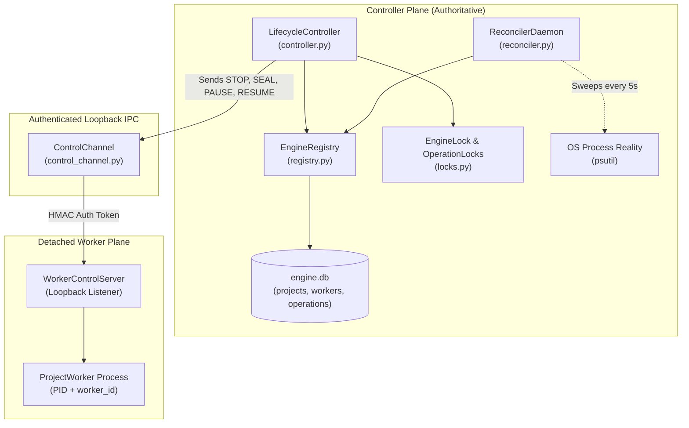

# Technical Specification: Lifecycle Authority & Controller Subsystem

> **Document ID:** SPEC-001  
> **Target Subsystem:** `scripts/controller/` & `scripts/core/`  
> **Status:** Current Production Architecture  
> **Author:** Antigravity, Senior Systems Architect  

---

## 1. Architecture & Approach

The **Lifecycle Authority & Controller Subsystem** resolves split-brain lifecycle ownership by establishing a single source of truth for process reality and project state. In legacy architectures, independent supervisors, HTTP GET routes, and background reaper threads independently attempted to terminate, reap, or archive projects, causing race conditions and lost worker states upon resume.

In the current production architecture:
1. **Single Authoritative Controller:** `LifecycleController` (`scripts/controller/controller.py`) is the sole entity authorized to transition project lifecycles.
2. **Central State Ledger (`data/engine.db`):** Tracks projects, active worker processes, operational locks, and durable jobs in a versioned SQLite database managed by `EngineRegistry`.
3. **Multi-Attribute Process Verification:** Worker processes are assigned an immutable UUID `worker_id` and verified using 5 mandatory attributes: PID, process creation timestamp, executable path, exact `worker_id` command token, and canonical project target root. Substring matching is strictly eliminated.
4. **Authoritative Reconciler Daemon:** A background loop (`ReconcilerDaemon`) executes every 5 seconds to reconcile `engine.db` state against verified OS process reality. The reconciler is the **sole authority** permitted to declare an unexpected process termination (`INTERRUPTED`).
5. **Loopback Authenticated Control Channel:** IPC between the controller and detached workers operates over local loopback sockets using `multiprocessing.connection` or HTTP authenticated via ephemeral per-instance secrets.



---

## 2. Core Classes & Technical Reference

### 2.1 `LifecycleController` (`scripts/controller/controller.py`)
- **`resolve_project(project_id_or_slug)`**: Resolves project identity using exact `project_id`, slug, or slugified display name.
- **`register_project(display_name, root_path, ...)`**: Thread-safe upsert of project records guarded by `EngineLock`.
- **`start_project(project_id_or_slug, ...)`**: Serialized worker launch guarded by `ProjectOperationLock`.
- **`stop_project(project_id_or_slug, ...)`**: Dispatches cooperative stop command via IPC and waits up to grace deadline.

### 2.2 `EngineRegistry` (`scripts/controller/registry.py`)
- **`upsert_project(...)`**: Inserts or updates records in `engine.db.projects`.
- **`register_worker(...)`**: Records new worker instance in `engine.db.workers` (`worker_id`, `pid`, `process_create_time`, `started_at`).
- **`get_active_worker(project_id)`**: Returns active worker record with PID and creation timestamp.
- **`transition_project_state(project_id, new_state)`**: Executes atomic state transition.

### 2.3 `Reconciler` & `ReconcilerDaemon` (`scripts/controller/reconciler.py`)
- **`reconcile_once()`**: Single pass comparing registered non-terminal projects against OS processes.
- **Rules Enforced:**
  - `gone` $\rightarrow$ `INTERRUPTED` (guarded by startup grace period).
  - `valid unknown worker` $\rightarrow$ `ADOPT`.
  - `unknown unverifiable worker` $\rightarrow$ `ORPHANED`.
  - `stale heartbeat` $\rightarrow$ `UNRESPONSIVE` (never automatically killed).
- **Invariants:**
  - A stale heartbeat never triggers process termination.
  - Reconciler never archives a project solely because a PID died.
  - Workers within `startup_grace_s` (10.0s) are immune to death declarations.

### 2.4 `ProjectState` Machine (`scripts/controller/lifecycle.py`)
Governs legal transitions:
```text
STOPPED    -> STARTING
STARTING   -> INDEXING, ACTIVE, FAILED, INTERRUPTED
INDEXING   -> ACTIVE, INTERRUPTED
ACTIVE     -> STOPPING, UNRESPONSIVE, INTERRUPTED
UNRESPONSIVE -> ACTIVE, STOPPING, INTERRUPTED
STOPPING   -> STOPPED, INTERRUPTED
INTERRUPTED -> STARTING
FAILED     -> STARTING
```

### 2.5 `ControlChannelHandler` & `WorkerControlServer` (`scripts/controller/control_channel.py`)
- **Protocol:** JSON over loopback HTTP (Protocol Version 1).
- **Authentication:** Validates `X-Worker-Token` header using a per-worker shared secret. Secrets are generated dynamically and passed via environment variables or secure configs, never command-line arguments.
- **Idempotency:** Repeated commands (`STOP`, `SEAL`, `PAUSE`, `RESUME`, `PING`) return current state with success rather than failing.

---

## 3. Data Flow & Execution Sequences

### 3.1 Worker Start Sequence
1. Caller executes `python start.py start` or clicks **Start Monitoring** in the Web Dashboard (`POST /api/project/start`).
2. `LifecycleController` acquires `ProjectOperationLock(slug)`.
3. Checks `is_valid_transition(current_state, STARTING)`. Transitions project to `STARTING`.
4. Writes operation record to `engine.db.operations` via `track_operation()`.
5. Calls `Spawner.spawn_detached_worker()`:
   - Allocates unique `worker_id = uuid.uuid4().hex`.
   - Generates loopback auth token.
   - Spawns detached OS process (`CREATE_NEW_PROCESS_GROUP | DETACHED_PROCESS` on Windows).
6. Spawner polls for `worker.pid` and `worker.status.json` (up to 8.0s).
7. Worker publishes PID and enters initial scan. Controller transitions project state to `ACTIVE`.

### 3.2 Worker Stop Sequence
1. Caller executes `python start.py stop` or clicks **Stop** in UI.
2. Controller acquires `ProjectOperationLock(slug)`.
3. Dispatches `STOP` command over loopback IPC via `send_worker_command()`.
4. Worker's `WorkerControlServer` receives `STOP`, initiates `_clean_shutdown()`:
   - Pauses watcher ingestion.
   - Flushes in-flight events to `BurstAssembler`.
   - Forces burst commit in `ShadowGit`.
   - Removes `worker.pid` and updates `worker.status.json` with exit code `0`.
5. If worker fails to exit within 20s grace period, spawner escalates: `stop.cmd` $\rightarrow$ `SIGTERM` $\rightarrow$ `SIGKILL`. Escalated stops are recorded as `INTERRUPTED`.
