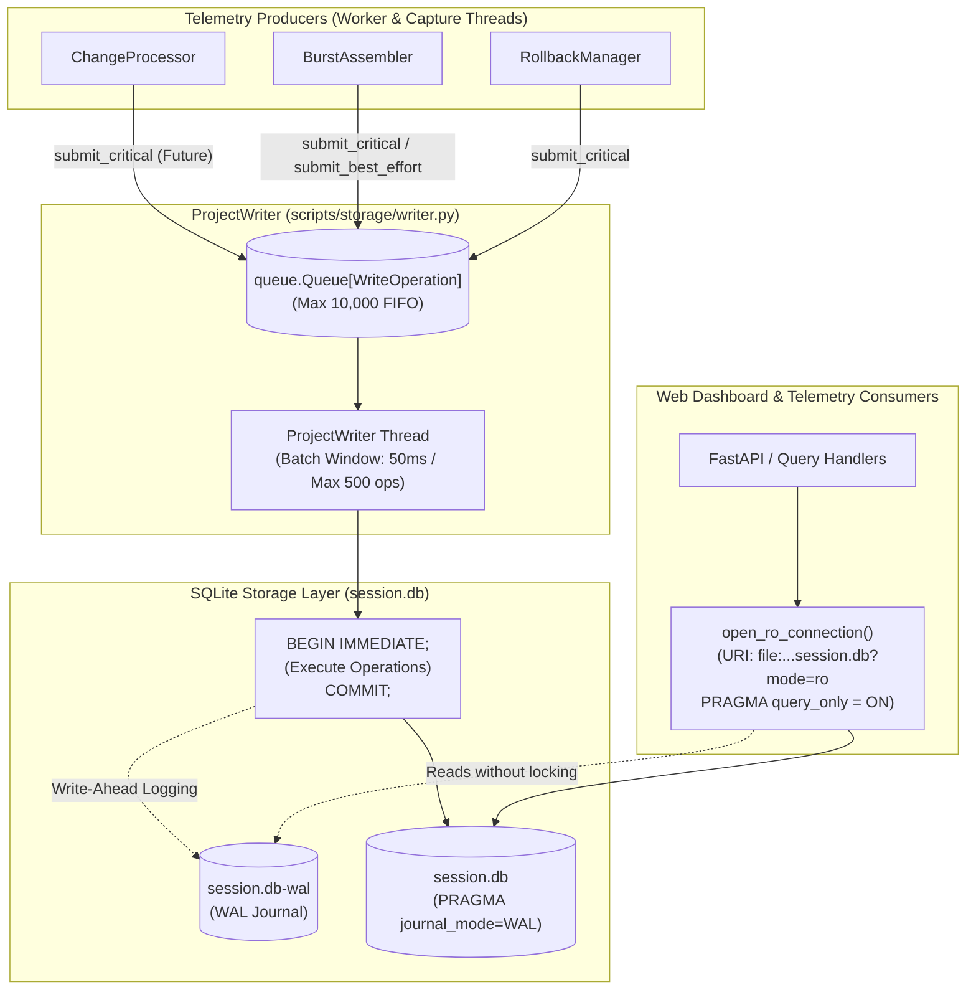

# Technical Specification: Storage Engine & ProjectWriter Subsystem

> **Document ID:** SPEC-002  
> **Target Subsystem:** `scripts/storage/`  
> **Status:** Current Production Architecture  
> **Author:** Antigravity, Senior Systems Architect  

---

## 1. Architecture & Approach

The **Storage Engine & ProjectWriter Subsystem** provides a zero-contention, ACID-compliant, single-writer telemetry architecture for per-project telemetry databases (`data/projects/<slug>/session.db`). 

### Core Architectural Decisions & Invariants
1. **Single-Writer Dedicated Thread:** SQLite enforces database-level locks on write transactions. Allowing multiple threads or processes to write directly to `session.db` leads to `sqlite3.OperationalError: database is locked` exceptions and indeterminate state under high filesystem activity. In this architecture, exactly one background thread (`ProjectWriter-<slug>`) owns the single writable connection for each project.
2. **Asynchronous Bounded Ingestion with FIFO Ordering:** Telemetry events and patches are ingested via a bounded thread-safe FIFO queue (`queue.Queue[WriteOperation]`, default capacity: 10,000 items).
3. **Adaptive Batching Window:** The writer thread flushes enqueued operations in atomic SQLite transactions triggered either when `max_batch_size` (500 operations) is reached or when `batch_window_s` (50ms) elapses.
4. **Dual Durability Modes:**
   - **Durability-Critical Writes (`submit_critical`):** Returns a `concurrent.futures.Future`. Blocks the calling thread on queue backpressure until space is available. Resolves or raises an exception upon `COMMIT` or `ROLLBACK`.
   - **Best-Effort Writes (`submit_best_effort`):** Non-blocking (`put_nowait`). If the queue reaches capacity or the writer is stopping, drops the write and increments an observable `_dropped_count` counter.
5. **Zero-Contention Concurrent Readers:** Web dashboard endpoints and analytics workers open independent read-only SQLite connections via `open_ro_connection()` using SQLite URI mode (`file:...session.db?mode=ro`) with `PRAGMA query_only = ON;` and `PRAGMA busy_timeout = 30000;`. Read queries never compete with the writer thread or block write commits.
6. **Transactional PRAGMA Tuning:**
   - `PRAGMA busy_timeout = 30000;` (30 seconds)
   - `PRAGMA journal_mode = WAL;` (Write-Ahead Logging enables concurrent readers + writer)
   - `PRAGMA synchronous = NORMAL;` (Safe with WAL, reduces fsync overhead)
   - `PRAGMA foreign_keys = ON;` (Referential integrity enforcement)
7. **Versioned Migrations via `PRAGMA user_version`:** Schema evolutions from v1 to v5 execute inside an explicit atomic transaction during connection initialization before telemetry writes begin.



---

## 2. Core Classes & Technical Reference

### 2.1 `ProjectWriter` (`scripts/storage/writer.py`)
- **`__init__(db_path, batch_window_s=0.05, max_batch_size=500, max_queue_size=10000)`**: Initializes database directory, opens the dedicated write connection, applies schema migrations, and spawns the background worker thread.
- **`_open_writer_connection()`**: Opens the sole writable connection (`check_same_thread=False`, `isolation_level=None`), configures WAL mode, sets busy timeout, and runs migrations.
- **`open_ro_connection() -> sqlite3.Connection`**: Static/instance factory returning an isolated read-only connection configured with `?mode=ro` URI parameter and `PRAGMA query_only = ON`.
- **`submit_critical(op_type, payload, timeout=None) -> Future`**: Submits a write operation with an attached Future. Blocks if queue is full.
- **`submit_best_effort(op_type, payload) -> bool`**: Submits a non-blocking write operation. Returns `False` and increments `_dropped_count` if queue is full.
- **`_writer_loop()`**: Dedicated thread loop that drains operations into a batch up to `max_batch_size` or until `batch_window_s` elapses.
- **`_flush_batch(batch)`**: Executes `BEGIN IMMEDIATE;`, calls `execute_operation()` for each item, issues `COMMIT;`, resolves futures, or issues `ROLLBACK;` and propagates exceptions to all futures in the batch.
- **`drain(timeout=10.0)`**: Blocks until `queue.empty()` and all pending items have completed `task_done()`.
- **`stop(drain=True, timeout=10.0)` / `close(...)`**: Flushes pending writes, sets stop flag, joins thread, issues `PRAGMA wal_checkpoint(TRUNCATE);`, and closes the connection cleanly.
- **`get_metrics() -> WriterMetrics`**: Returns instantaneous snapshot of queue depth, commit count, drop count, average batch size, and backpressure state.

### 2.2 `WriteOperation` & `execute_operation` (`scripts/storage/writer_ops.py`)
- **`WriteOperation`**: Dataclass packaging `op_type`, `payload`, optional `Future`, `is_critical` flag, sequence counter, and submission timestamp.
- **`execute_operation(conn, op)`**: Dispatcher executing SQL operations:
  - `event`: Inserts canonical event with auto-computed or explicit sequence (`seq`), `event_id`, `burst_uid`, and `effective_files`.
  - `patch`: Inserts unified diff, computed byte sizes, addition/deletion line counts, and file content hashes (`hash_before`, `hash_after`).
  - `session_create` / `session_close`: Manages session lifecycle records, tracking `end_reason`, `worker_id`, `config_json`, and actor.
  - `manifest`: Upserts tracked file metadata with SHA-256 fingerprint, byte size, and modification timestamp using `ON CONFLICT(file_path) DO UPDATE`.
  - `git_attribution`: Records mapping between Git commit SHA, author identity, timestamp, milestone ID, and burst IDs.
  - `capture_meta`: Key-value configuration metadata upsert.
  - `sql` / `custom`: Executes raw parameterized SQL or executes a callable against the connection.

### 2.3 `SchemaMigration` (`scripts/storage/schema_migration.py`)
- Manages incremental database evolution tracked via SQLite's native `PRAGMA user_version`:
  - **v1 Baseline:** Tables `sessions`, `events`, `patches`, `git_milestones` with foreign keys and indexes.
  - **v2 Durable Project Schema:** Canonical `event_id`, ordering `seq`, `burst_uid`, `effective_files`, patch metrics (`adds`, `dels`, `kind`, `size`, `hash_before`, `hash_after`, `truncated`), and session metadata (`worker_id`, `end_reason`, `config_json`). Backfills legacy records with stable keys.
  - **v3 Worker-Owned Data:** Adds `manifest` (tracked files and hashes), `git_attribution` (commit mapping), and `capture_metadata`.
  - **v4 Durable Git Recovery:** Adds `git_state` and `git_error` to `events`, and creates `git_ops` table to track burst Git executions across restarts.
  - **v5 Non-Destructive Rollback:** Adds `rollback_state` (`active`, `rolled_back`, `superseded`) and `superseded_by` to `events`, and creates `rollbacks` audit log table.
- **`apply_schema_migrations(conn, target_version=5, dry_run=False) -> MigrationReport`**: Executes migrations transactionally. If an error occurs, rolls back and preserves the previous version.

---

## 3. Data Flow: Life of a Write Operation

```mermaid
sequenceDiagram
    autonumber
    participant Caller as ChangeProcessor / Worker
    participant PW as ProjectWriter
    participant Queue as Queue[WriteOperation]
    participant Loop as Background Writer Thread
    participant DB as SQLite (session.db)

    Caller->>PW: submit_critical("event", payload)
    PW->>Queue: put(WriteOperation(op, future))
    Note over PW,Caller: Caller awaits future.result(timeout=10.0)

    Loop->>Queue: get(timeout=0.05)
    Note over Loop: Gathers batch up to 500 ops or 50ms
    Loop->>DB: BEGIN IMMEDIATE;
    loop For each op in batch
        Loop->>DB: execute_operation(conn, op)
    end
    alt Commit Success
        Loop->>DB: COMMIT;
        Loop->>Caller: future.set_result(row_id)
    else Commit Failure / SQLite Error
        Loop->>DB: ROLLBACK;
        Loop->>Caller: future.set_exception(exc)
    end
```

---

## 4. Concurrency Model & Lock Invariants

1. **Zero Contention by Design:** No application thread outside `ProjectWriter` ever initiates an `INSERT`, `UPDATE`, or `DELETE` on `session.db`.
2. **Immediate Transactions:** Transactions use `BEGIN IMMEDIATE;` to obtain a reserved lock immediately, preventing writer deadlocks with any external checkpoints.
3. **WAL Mode Checkpointing:** On clean shutdown (`stop()`), `PRAGMA wal_checkpoint(TRUNCATE);` is executed to consolidate WAL frames into the main database file, eliminating stale lock files and shrinking disk footprints.
4. **Queue Backpressure Protection:** If the FIFO queue reaches 80% capacity (8,000 items), `WriterMetrics.backpressure_active` flips to `True`. Critical submissions block, enforcing natural upstream capture rate throttling.

---

## 5. Failure Recovery & Error Handling

- **Database Locked / Busy Timeout:** Configured at 30,000ms. If SQLite is temporarily blocked by an external backup or reader, the writer will retry internally for up to 30 seconds before timing out.
- **Transaction Rollback:** If any statement in a batch throws an exception, the entire batch issues `ROLLBACK;`. The exception is distributed to every waiting Future in that batch, preventing partial database corruption.
- **Crash Durability:** SQLite WAL mode ensures that uncommitted transactions are rolled back automatically on reopen. Any committed operations are guaranteed written to disk. The `git_ops` and `events.git_state` tables persist operations to enable resuming interrupted workflows upon boot.
