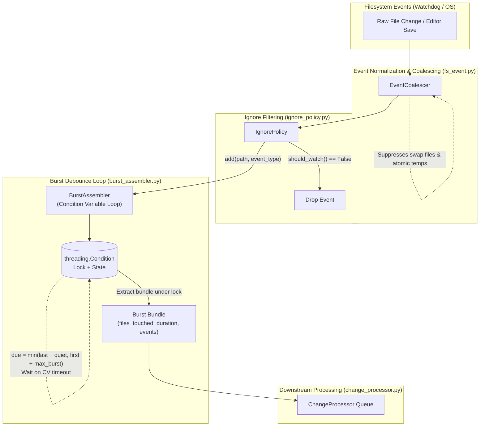
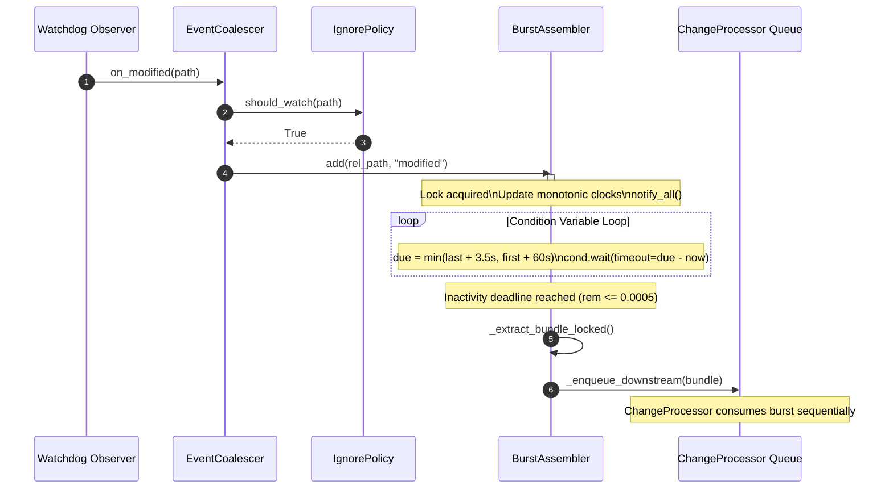

# Technical Specification: Capture Pipeline & BurstAssembler Subsystem

> **Document ID:** SPEC-003  
> **Target Subsystem:** `scripts/core/` & `scripts/storage/ignore_policy.py`  
> **Status:** Current Production Architecture  
> **Author:** Antigravity, Senior Systems Architect  

---

## 1. Architecture & Approach

The **Capture Pipeline & BurstAssembler Subsystem** is responsible for real-time filesystem observation, high-frequency event coalescing, ignore rule evaluation, and deterministic burst bundling. 

In legacy systems, event debouncing relied on arbitrary `threading.Timer` objects, which led to race conditions, overlapping debounces, unbounded memory leaks, and dropped events during rapid IDE saves.

The modern production architecture replaces timer-based debouncing with an authoritative **condition-variable aggregation loop** and a multi-tiered filtering pipeline:

1. **Normalized Event Model (`FsEvent`):** Low-level watchdog events are converted into immutable `FsEvent` instances (`created`, `modified`, `deleted`, `renamed`) with millisecond timestamps.
2. **Editor Atomic-Save Coalescing (`EventCoalescer`):** Editors like VS Code, JetBrains, and Vim perform atomic saves by writing to temporary files (`.tmp`, `.swp`, `4913`), renaming them over the target, or issuing delete-recreate sequences. The coalescer suppresses temporary file churn and resolves atomic sequences into clean target mutations.
3. **Four-Layer Ignore Hierarchy (`IgnorePolicy`):** Evaluates paths against built-in engine artifacts, `.gitignore`, `.spdignore`, and sensitive file patterns. Evaluates separate boolean permissions for watching, indexing, diffing, staging, and sending to AI.
4. **Deterministic Condition-Variable Burst Debouncing (`BurstAssembler`):** Completely eliminates `threading.Timer`. Uses a dedicated aggregation thread and `threading.Condition`. The due time is strictly calculated as:
   $$\text{due} = \min(\text{last\_event} + \text{quiet\_period}, \text{first\_event} + \text{max\_burst\_s})$$
5. **Bounded Queues & Drop Accounting:** Queues are bounded at 20,000 pending events to prevent out-of-memory errors during bulk filesystem operations (e.g., massive Git checkouts). Overflows trigger `needs_reconcile = True` and increment atomic drop counters.



---

## 2. Core Classes & Technical Reference

### 2.1 `BurstAssembler` (`scripts/core/burst_assembler.py`)
- **Parameters:**
  - `quiet_period`: Sliding inactivity window (default: `3.5s`, minimum: `0.005s`).
  - `max_burst_s`: Maximum allowed duration for a single continuous burst before forcing a flush (default: `60.0s`).
  - `max_queue_size`: Bound on unique pending file paths (default: `20,000`).
- **`add(file_path, event_type="modified", timestamp=None) -> bool`**:
  - Rejects submissions if stopped.
  - If `len(_pending_events) >= max_queue_size` and `file_path` is new, sets `needs_reconcile = True`, increments `drop_counter`, logs a warning, and returns `False`.
  - Records monotonic timestamps (`_first_event_mono`, `_last_event_mono`), increments per-file `edit_count`, updates `seq`, and executes `self._cond.notify_all()`.
- **`_assembler_loop()`**:
  - The heartbeat condition-variable loop:
    ```python
    while running:
        wait until pending or stopped
        due = min(last_event + quiet_period, first_event + max_burst)
        wait until due or notification (timeout = due - now)
        recompute due after every notification
        if rem <= 0.0005:
            extract exactly one ordered bundle under lock
            enqueue downstream outside the lock
    ```
- **`_extract_bundle_locked() -> dict[str, Any] | None`**:
  - Sorts pending events by sequential arrival order (`seq`).
  - Assembles metadata payload (`event_type="EDIT"`, `files_touched`, `first_file`, `duration_s`, `needs_reconcile`, `flushed_at`).
  - Clears pending maps and resets monotonic clock references.
- **`flush_now()` / `stop(drain=True)`**:
  - Manually extracts any uncommitted events, pushes to downstream queue, and joins the background worker thread.

### 2.2 `EventCoalescer` & `FsEvent` (`scripts/core/fs_event.py`)
- **`FsEvent`**: Immutable dataclass containing `kind` (`created`, `modified`, `deleted`, `renamed`), `rel_path`, `timestamp`, and optional `old_rel_path`.
- **`is_editor_temp_file(rel_path)`**: Filters swap files and editor artifacts (`.tmp`, `.swp`, `.swo`, `.bak`, `~`, `4913`, `#*#`).
- **`EventCoalescer`**: Buffers rapid sequences occurring within `coalesce_window_s` (50ms). If a delete is rapidly followed by a create for the same file, it is coalesced into a single `modified` event. Directory renames are expanded into constituent file renames using manifest state.

### 2.3 `IgnorePolicy` (`scripts/storage/ignore_policy.py`)
- Unified evaluation hierarchy:
  1. **Built-in Noise:** Ignores internal directories (`.git`, `.spd`, `node_modules`, `.venv`, `__pycache__`, `.idea`, `.vscode`) and engine runtime files (`session.db*`, `engine.db*`, `*.lock`, `worker.pid`).
  2. **Project `.gitignore`:** Parses standard Git ignore patterns with negation support (`!`).
  3. **Project `.spdignore`:** Parses project-specific override rules.
  4. **Sensitive File Blocklist:** Glob patterns (`.env*`, `*.pem`, `*.key`, `id_rsa*`, `credentials*`, `*.pfx`).
- **Authoritative Policy Methods:**
  - `should_watch(path)`: True if the watchdog observer should register file updates.
  - `should_index(path)`: True if metadata (size, hash) belongs in `file_manifest`.
  - `should_diff(path)`: True if diff computation is permitted (**strictly False** for sensitive files).
  - `should_stage(path)`: True if file should be added to Shadow Git (**strictly False** for sensitive files).
  - `should_send_to_ai(path)`: True if code content may be sent to LLM prompts (**strictly False** for sensitive files).

---

## 3. Data Flow: Event Ingestion to Downstream Queue



---

## 4. Concurrency & Timing Guarantees

1. **Zero Timer Drift:** By relying on monotonic system clocks (`time.monotonic()`) rather than wall clocks or recursive timer callbacks, the assembler is immune to system clock shifts, daylight savings, or thread starvation drift.
2. **Deterministic Max-Burst Enforcement:** Even under relentless, continuous file updates (e.g., automated code generators or test suites emitting continuous file writes), the assembler guarantees bundle extraction within `max_burst_s` (60 seconds) from the arrival of the first event.
3. **Queue Extraction Decoupling:** Bundles are extracted from internal maps under lock, but downstream queue insertion (`_enqueue_downstream`) occurs outside the lock with a 5.0-second timeout, ensuring the capture thread is never permanently stalled by a busy processor.

---

## 5. Failure Modes & Edge Case Recovery

- **Queue Overflow:** If the number of distinct modified files exceeds `max_queue_size` (20,000), the incoming file is rejected, `needs_reconcile` is set to `True`, and `drop_counter` is incremented. When downstream processes receive a bundle with `needs_reconcile == True`, a full directory reconciliation scan is scheduled to restore consistency.
- **Process Termination during Burst:** When `stop(drain=True)` is called during an active burst, `flush_now()` immediately seals the in-flight bundle and enqueues it, ensuring zero data loss during graceful shutdowns.
