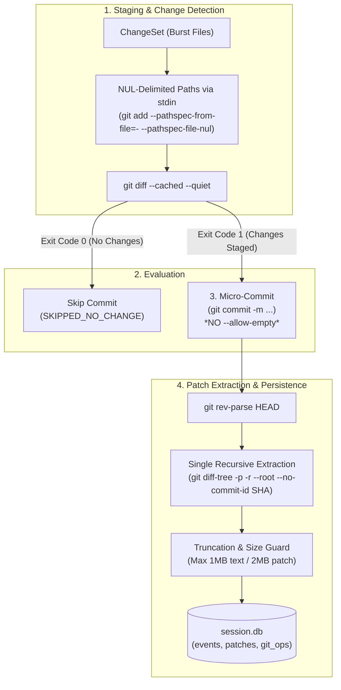
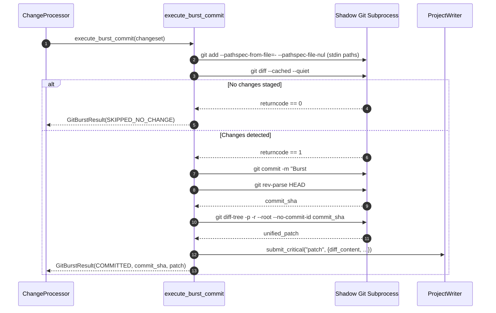
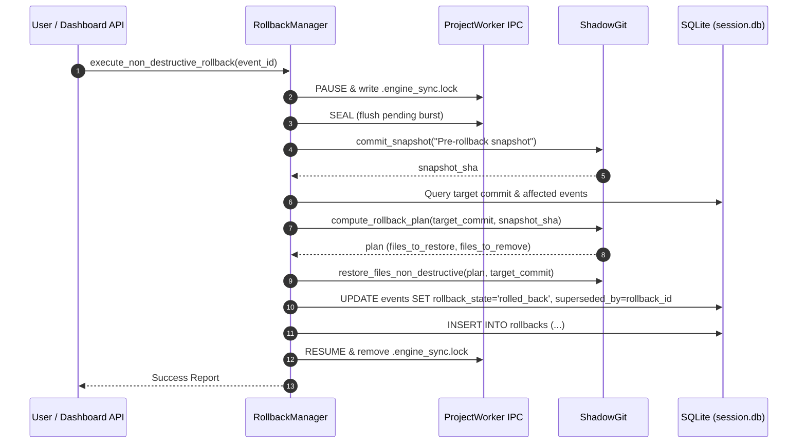

# Technical Specification: Shadow Git & Versioning Subsystem

> **Document ID:** SPEC-004  
> **Target Subsystem:** `scripts/git/` & `scripts/storage/rollback.py`  
> **Status:** Current Production Architecture  
> **Author:** Antigravity, Senior Systems Architect  

---

## 1. Architecture & Approach

The **Shadow Git & Versioning Subsystem** provides transparent, non-intrusive micro-versioning of user codebases without interfering with the user's primary Git repository. It creates and maintains an isolated Git database inside `data/projects/<slug>/shadow_git/` where the working tree points to the user's active workspace.

### Core Architectural Problems Solved
1. **Windows Command-Line Length Overflow:** On Windows, `CreateProcess` enforces a hard 8,191-character limit on command-line arguments. Passing hundreds of modified files to `git add <files>` crashes. The subsystem bypasses this limit by feeding NUL-delimited relative paths through standard input using `git add --pathspec-from-file=- --pathspec-file-nul`.
2. **Elimination of Subprocess Storms:** Legacy systems invoked `git diff` separately for each file in a burst. The modern architecture executes a single recursive `git diff-tree -p -r --root --no-commit-id <commit_hash>` command per burst, reducing process spawning by orders of magnitude.
3. **Ghost Commit Prevention:** Staging is followed by `git diff --cached --quiet`. If staged files produce zero diff against `HEAD`, the commit is skipped (`SKIPPED_NO_CHANGE`). The engine strictly forbids `git commit --allow-empty`.
4. **Subprocess Isolation:** Automation environments can hang indefinitely if Git prompts for credentials. The subsystem enforces `GIT_TERMINAL_PROMPT = "0"`, strips global `GIT_DIR`/`GIT_WORK_TREE` environment variables, and enforces explicit subprocess execution timeouts.
5. **Durable Crash Recovery:** Git operations are recorded in SQLite (`git_ops` and `events.git_state`), allowing incomplete or failed burst commits to be recovered or reconciled upon engine reboot.
6. **Non-Destructive Rollbacks:** Rollbacks snapshot the workspace before restoring earlier states, compute dry-run restoration plans, update SQLite event lineage (`superseded_by`), and never invoke destructive commands like `git clean -fd`.

---

## 2. Core Classes & Technical Reference

### 2.1 `execute_burst_commit` (`scripts/git/shadow_commit.py`)
- **Authoritative 4-Step Pipeline:**
  1. **Staging (`stage_paths_nul`):** Filters transient files and streams NUL-delimited paths to `git add --pathspec-from-file=- --pathspec-file-nul`.
  2. **Diff Validation:** Executes `git diff --cached --quiet`. If returncode is `0`, returns `GitBurstResult(state=GitState.SKIPPED_NO_CHANGE)`.
  3. **Commit Creation:** Executes `git commit -m "Burst #<seq>: [<first_file>] 
"`. Prohibits `--allow-empty`. Obtains commit hash via `git rev-parse HEAD`.
  4. **Diff-Tree Extraction:** Executes `git diff-tree -p -r --root --no-commit-id <commit_hash>`. Applies `truncate_patch_content()` to prevent out-of-memory errors on massive diffs.
- **`GitState` Enum:** `PENDING`, `RUNNING`, `COMMITTED`, `SKIPPED_NO_CHANGE`, `SKIPPED_OVERLOAD`, `FAILED`.

### 2.2 `ShadowGit` (`scripts/git/shadow_repo.py`)
- **`init_repository()`**: Initializes `shadow_git/` repository pointing to the project target workspace. Sets hardened configuration:
  - `gc.auto = 0` (Prevents automatic garbage collection from blocking file writes)
  - `core.longpaths = true` (Supports Windows long paths > 260 chars)
  - `core.quotepath = false` (UTF-8 preservation for international filenames)
  - `core.autocrlf = false` (Byte-for-byte line ending preservation)
  - `core.fsmonitor = false` (Disables external file system monitors)
  - `commit.gpgsign = false` (Disables commit signing)
  - `user.name = "SPD Shadow Engine"` & `user.email = "spd-shadow@local"`
- **`commit_snapshot(message)`**: Stages all tracked files and creates a fallback commit point before potentially destructive operations.
- **`compute_rollback_plan(target_commit, current_commit)`**: Compares commits using `git diff-tree` to generate explicit lists of `files_to_restore` and `files_to_remove`.
- **`restore_files_non_destructive(plan, target_commit)`**: Checks out required files directly from the target commit hash using `git checkout <commit> -- <files>` and safely moves unneeded files to a `.rollback_trash/` holding directory rather than unlinking them with `git clean -fd`.

### 2.3 `RollbackManager` (`scripts/storage/rollback.py`)
- **`execute_non_destructive_rollback(...)`**:
  1. **Locking & Suppression:** Writes `.engine_sync.lock` in the project root and transmits `PAUSE` IPC to the active worker.
  2. **Sealing:** Sends `SEAL` IPC to flush and persist any pending burst in the capture pipeline.
  3. **Safety Snapshot:** Creates a pre-rollback snapshot commit in Shadow Git.
  4. **Plan Generation:** Resolves `target_commit` from SQLite, gathers affected events, and computes the restoration plan.
  5. **Safety Confirmation:** Supports `dry_run=True` to inspect changes without applying them.
  6. **Restoration:** Restores target files without running bare `git clean -fd`.
  7. **Lineage Invalidation:** Updates SQLite records for subsequent events: `UPDATE events SET rollback_state = 'rolled_back', is_rolled_back = 1, superseded_by = ?`.
  8. **Audit Logging:** Inserts record into `rollbacks` table and logs synthetic `ROLLBACK` event into `session.db`.
  9. **Resumption:** Removes `.engine_sync.lock` and transmits `RESUME` IPC.

---

## 3. Data Flow: Burst Commit Lifecycle

---

## 4. Rollback Lifecycle & Invariants

---

## 5. Failure Modes & Edge Case Recovery

- **Mid-Commit Crash Recovery:** If the engine process terminates while `git_ops` status is `running`, the boot reconciler inspects `git_ops`. If the commit SHA exists in the shadow repo, it marks the op `committed`; otherwise, it re-stages and commits the burst ChangeSet.
- **Repository Corruption (`index.lock`):** If an aborted process leaves `.git/index.lock`, `ShadowGit` checks lock age. Locks older than 60 seconds without an active Git PID are safely unlinked before operations proceed.
- **Rollback Inversion:** Because rollbacks create a pre-rollback snapshot commit, any rollback can itself be reversed by executing a rollback to the snapshot commit.
